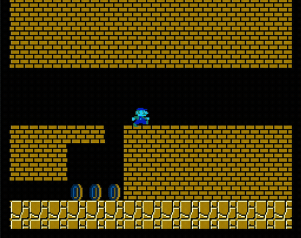

# Super Mario RL Agent

Training an agent to play **Super Mario Bros.** from pixels using PPO.

I built this project to explore how rewards affect what an agent learns. Does it keep moving through the level, stop to collect coins, or explore somewhere new? It uses **Stable-Baselines3** for PPO. My work is in the environment wrappers, reward shaping, curiosity with Random Network Distillation (RND), and tools for running and comparing experiments.

## Trained gameplay

The older training runs got through stage 1-1 and into stage 1-2. The highest-scoring
saved recording finished with 28,050 points.



This clip shows stage 4-2 in an earlier version of the project. It's cropped from
a viewer recording running at 2× playback speed. It is separate from the PPO
checkpoint evaluations below. [Watch the MP4](docs/media/earlier-version.mp4).

I re-evaluated the saved checkpoints and put the numbers in [the historical results](results/historical/README.md).
They show what the trained agents can do, though none of these evaluations reached
stage 1-3. The PPO-versus-RND comparison below is a separate, much shorter run.

## Approach

The agent chooses actions from images alone. When collection or coverage rewards
are enabled, the reward wrappers also use game-state information such as coins and
position. Evaluation uses those fields to track progress too.

Frames are max-pooled, resized to 84 × 84 grayscale images, and stacked four at a
time before reaching the CNN policy.

- **PPO:** NatureCNN features, categorical action policy, and a value head.
- **Collection rewards:** bonuses for score gains, coins, and power-ups.
- **Coverage:** a bonus for entering a new 16-pixel spatial cell within an episode.
- **RND:** prediction error against a frozen random network encourages unfamiliar visual states.

This version of RND updates its predictor at each vector step and uses one PPO value
head for the combined reward. It doesn't reproduce every detail of the original
paper. [The algorithm notes](docs/RL_ALGORITHM.md) explain the equations and how the
wrappers fit together.

## Setup

Use **Python 3.13 or later** for the pinned dependencies. I've tested installation
and short training runs on macOS Apple Silicon with Python 3.13. On macOS, you may
need Xcode Command Line Tools to build `nes-py`.

With [uv](https://docs.astral.sh/uv/):

```bash
uv venv --python 3.13 .venv
source .venv/bin/activate
uv pip install -e '.[dev]'
```

Or with Python and pip:

```bash
python3.13 -m venv .venv
source .venv/bin/activate
python -m pip install -e '.[dev]'
```

The Mario environment comes from `gym-super-mario-bros`. This repo doesn't contain
ROM files. See that package for its assets and licensing.

## Train

Start with a short run to check that everything works:

```bash
python -m src.train --config configs/ppo_world1_1.yaml --smoke
```

Smoke runs use separate directories under `runs/ppo_world1_1/smoke/`. Normal runs get timestamped directories under `runs/ppo_world1_1/experiments/`. Each run contains its resolved configuration, metadata, checkpoints, evaluation logs, and final model.

To choose where a run is saved:

```bash
python -m src.train --config configs/ppo_world1_1.yaml \
  --run-dir runs/baseline_seed0
```

Training won't overwrite an existing run. You can change the seed and settings in
YAML for another experiment. `total_timesteps` counts agent transitions across all
environments, not raw emulator frames.

| Configuration | Environment | Reward additions | Actions |
|---|---|---|---|
| `ppo_world1_1.yaml` | Stage 1-1 | None | 7 |
| `ppo_human.yaml` | Stage 1-1 | Collection + RND | 7 |
| `ppo_human_1_2.yaml` | Stage 1-2 | Collection + RND | 7 |
| `ppo_fullgame.yaml` | Continuous stages | Collection + coverage + RND | 7 |
| `ppo_explore.yaml` | Continuous stages | Collection + coverage + RND | 12 |

The older configs call the collection reward flag `humanlike`. It adds collection
bonuses, but the name isn't a claim that the agent behaves like a person.

### Resume and transfer

```bash
# Continue a particular run. YAML supplies the additional transition budget.
python -m src.train --config runs/baseline_seed0/config.yaml \
  --resume runs/baseline_seed0/final_model.zip

# Start a new run using pretrained policy weights and a fresh optimizer.
python -m src.train --config configs/ppo_human_1_2.yaml \
  --init-from runs/baseline_seed0/final_model.zip \
  --run-dir runs/transfer_1_2
```

Resume restores the saved PPO settings and optimizer. The run metadata records both
the requested YAML and the settings actually used. If the run uses curiosity, keep
the matching `.rnd.pt` file with each checkpoint. Older checkpoints without it can
still provide starting weights for a new run.

For changes such as a larger action space, `--transfer-from` copies tensors with
matching names and shapes. Check that the action meanings still make sense.
Resuming starts new emulator episodes, so it won't replay the exact continuation
of the original run.

## Evaluate and watch

Use the configuration saved in the run:

```bash
python -m src.evaluate --config runs/baseline_seed0/config.yaml \
  --model runs/baseline_seed0/final_model.zip --episodes 5 \
  --metrics runs/baseline_seed0/evaluation.json \
  --video runs/baseline_seed0/gameplay.mp4

python -m src.watch --config runs/baseline_seed0/config.yaml \
  --model runs/baseline_seed0/final_model.zip

python -m src.autorecord --config runs/baseline_seed0/config.yaml \
  --run-dir runs/baseline_seed0 --top-k 10 --episodes 3
```

Evaluation saves return, episode length, score, coins, stage progression, and
coverage when enabled. It leaves out curiosity rewards. By default, the agent takes
its most likely action and the results go in a JSON file beside the model. Add
`--stochastic` to sample actions instead. Videos play at `60 / frame_skip` frames
per second.

The best checkpoint is chosen by average return without curiosity. Because reward
settings change that return, use stage completion and game score when comparing
agents trained with different rewards. A stage clear means one stage was cleared,
and horizontal position is measured within a stage.

For learning curves:

```bash
tensorboard --logdir runs
```

## Project layout

```text
src/
  config.py       YAML dataclasses and validation
  perception.py   Single-frame pixel preprocessing
  env.py          Environment factory and reward wrappers
  intrinsic.py    RND reward and checkpoint state
  train.py        Training, resume, and weight transfer
  callbacks.py    Metrics and paired checkpoint saving
  runs.py         Run directories and metadata
  compare.py      Matched PPO and RND experiments
  analyze.py      Per-seed metrics and comparison plots
  evaluate.py     Evaluation metrics and video
  watch.py        Live playback and checkpoint following
  autorecord.py   Score-ranked gameplay recordings
configs/          Experiment configurations
tests/            Tests for custom logic using small fake environments
docs/             Algorithm notes and experiment protocol
```

## Development

```bash
python -m unittest discover -s tests -v
ruff check .
ruff format --check .
```

Tests cover the custom reward logic, episode boundaries, configs, run directories,
and restoring checkpoints. Use `--smoke` to check training with the actual emulator.

## Experiments

To compare PPO with PPO + RND, the comparison runner keeps the base rewards,
actions, PPO settings, and training budget the same. It saves results for each seed
and plots learning curves.

```bash
uv pip install -e '.[analysis]'
python -m src.compare --pilot --seeds 0 1 --episodes 3 \
  --report-dir results/my_pilot
```

The [first pilot](results/pilot_stage1_1/README.md) used two seeds and only 2,048
transitions per method. Neither agent cleared stage 1-1. It was enough to check the
comparison tools, but too short to say whether curiosity helps.

The next step is a longer comparison across several seeds. [The experiment
protocol](docs/EXPERIMENTS.md) has the commands and evaluation setup for that run.

Generated models stay under `runs/`. Small reports can be kept under `results/`.

## References

- [Proximal Policy Optimization Algorithms](https://arxiv.org/abs/1707.06347)
- [Exploration by Random Network Distillation](https://arxiv.org/abs/1810.12894)
- [Stable-Baselines3](https://github.com/DLR-RM/stable-baselines3)
- [gym-super-mario-bros](https://github.com/Kautenja/gym-super-mario-bros)
