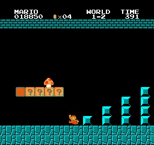

# Historical trained gameplay

These checkpoints demonstrate substantially more learning than the short pipeline
pilot. Fresh evaluation confirms stage 1-1 clears and progression to stage 1-2.
No evaluated episode reached stage 1-3 or demonstrated full-game completion.

| Checkpoint | Action selection | Episodes | Reached 1-2 | Max game score |
|---|---|---:|---:|---:|
| Full-game 1.6M | deterministic | 3 | 0 | 2,800 |
| Full-game 1.6M | stochastic | 10 | 4 | 28,050 |
| Full-game best | deterministic | 3 | 3 | 21,700 |
| Full-game best | stochastic | 10 | 6 | 27,650 |
| Explore best | deterministic | 3 | 0 | 1,700 |
| Explore best | stochastic | 10 | 0 | 2,100 |

The deterministic episodes repeat the same behavior in this environment. They are
not independent training runs. Sampled actions provide behavioral variation, but
these selected historical checkpoints do not form a controlled algorithm comparison.

The full-game best checkpoint has 2,899,884 saved transitions. The earlier full-game
checkpoint has 1,599,936. Explore best has its saved step count in summary.csv.
Training config provenance is incomplete, so the current YAML is not claimed as
an exact record of how these policies were trained.

## Gameplay example

This eight-second clip comes from the archived 28,050-point recording, starting at
25 seconds. Its final HUD score was visually checked. Fresh sampled evaluation of
the associated 1.6M checkpoint also reached 28,050 points.

## Evaluation protocol

Each checkpoint was evaluated for three deterministic and ten sampled-action
episodes. All used the native emulator reward with no additional collection,
coverage, or RND bonus. Episode reset seeds were 10,000 through 10,002 or 10,009.
The policies used their original seven- or twelve-action spaces.

Stage-clear signals are retained across action repeats. Maximum horizontal position
is stage-local, so progression is reported separately by world and stage. Portable
metrics and checkpoint hashes are in evaluations.json.

Model ZIPs and full recordings remain local artifacts under runs/ and are excluded
from the source commit. Re-evaluation requires the corresponding model file. The
hashes identify the evaluated weights if they are distributed separately later.
